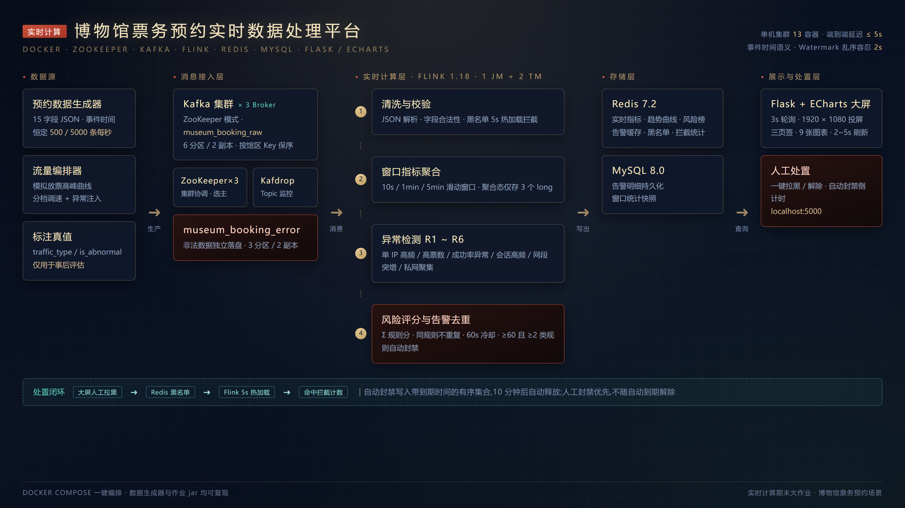
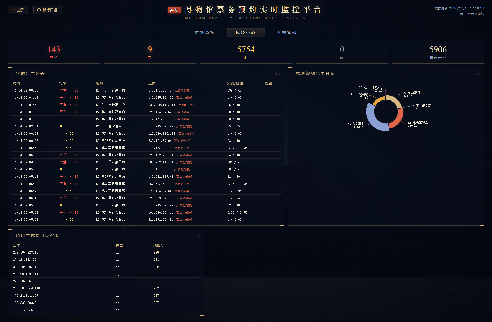
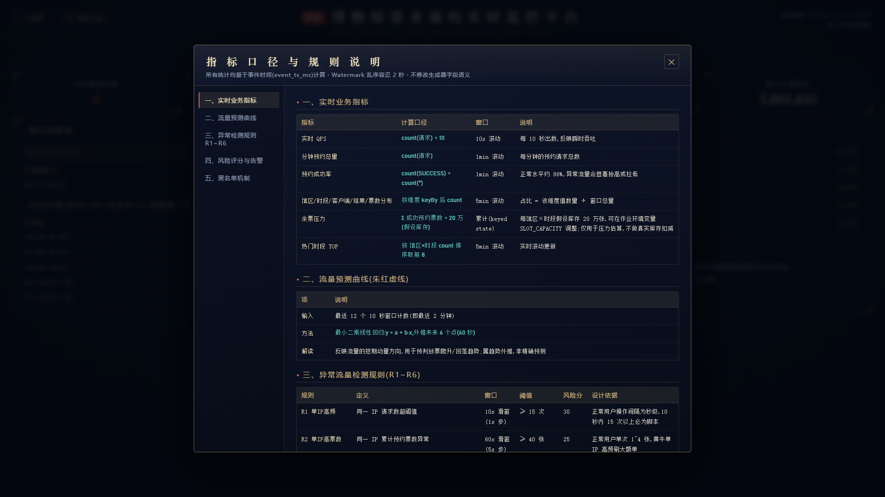

# 博物馆票务预约实时数据处理平台

《实时计算》期末大作业 —— 基于 **Docker + ZooKeeper + Kafka + Flink + Redis + MySQL + Flask/ECharts**
的博物馆票务预约实时数据处理平台,实现预约请求的**秒级采集、清洗、聚合、异常识别与可视化告警**。

## 1. 系统架构



| 组件 | 版本 | 角色 | 数量 |
|------|------|------|------|
| ZooKeeper | 3.7 | Kafka 集群协调 | 3 (zk1/zk2/zk3) |
| Kafka | apache/kafka 3.8.0(ZK 模式) | 消息队列 | 3 broker |
| Flink | 1.18 (Java 11) | 流式计算 | 1 JobManager + 2 TaskManager(各 2 slot) |
| Redis | 7.2 | 实时指标/风险榜/黑名单 | 1 |
| MySQL | 8.0 | 告警明细/窗口快照 | 1 |
| Kafdrop | 4.1.0 | Kafka Web UI | 1 |
| Dashboard | Python 3.11 + Flask + ECharts | 数据大屏 | 1 |

## 2. 快速启动

> 前置:Docker Desktop 已启动;宿主机安装 Python 3.10+(`pip install pyyaml confluent-kafka`);
> 宿主机安装 Maven + JDK 17+(仅重新构建作业 jar 时需要)。

```bash
cd museum-rt-platform

# 1. 一键启动全部组件(13 个容器)
docker compose up -d

# 2. 查看集群状态
docker compose ps

# 3. 创建 Kafka topic(6 分区 2 副本 + 错误 topic)
docker exec kafka1 /opt/kafka/bin/kafka-topics.sh --create --if-not-exists \
  --bootstrap-server kafka1:9092 --topic museum_booking_raw --partitions 6 --replication-factor 2
docker exec kafka1 /opt/kafka/bin/kafka-topics.sh --create --if-not-exists \
  --bootstrap-server kafka1:9092 --topic museum_booking_error --partitions 3 --replication-factor 2

# 4. 构建并提交 Flink 作业(首次构建)
mvn -f flink-job/pom.xml package -DskipTests
docker exec flink-jobmanager flink run -d -c com.museum.BookingJob /opt/jobs/museum-job.jar

# 5. 启动数据生成(二选一)
# 5a. 恒定速率高负载
python generator/museum_booking_gen.py --rate medium --sink kafka \
  --brokers localhost:29092 --topic museum_booking_raw --time-scale 60
# 5b. 流量编排器(模拟放票高峰的真实流量曲线,演示推荐)
python scripts/traffic_director.py --gen generator/museum_booking_gen.py --brokers localhost:29092
```

## 3. Web UI 访问

| 入口 | 地址 | 说明 |
|------|------|------|
| 数据大屏 | http://localhost:5000 | 态势总览 / 风控中心 / 系统管理 三页签 |
| Flink Dashboard | http://localhost:8081 | 作业状态、反压、Checkpoint |
| Kafdrop | http://localhost:9000 | Topic/分区/消费组积压 |

### 运行截图

**态势总览**:实时 QPS、预约成功率、分钟趋势与预测、馆区/时段/客户端分布、余票压力


**风控中心**:风险主体榜、实时告警、检测规则命中分布、异常流量时间线



**系统管理**:手动/自动黑名单管理、封禁倒计时、拦截统计与运行指标


**指标口径弹窗**:每个指标的计算口径、窗口类型与阈值说明



## 4. 核心功能

- **数据接入与清洗**:JSON 解析 + 字段合法性校验;非法数据 → `museum_booking_error` topic + Redis 计数
- **实时指标**:QPS/总量(10s、1min)、馆区/时段/客户端/结果/票数分布(5min 滑动窗口)、余票压力(keyed state 累计 ÷ 假设库存 20 万,可配)、热门时段 TOP、分钟趋势 + 秒级趋势 + 短窗口线性外推预测曲线
- **异常检测(6 条规则)**:R1 单IP高频(10s/1s 滑动窗口 ≥15)、R2 单IP高票数(60s ≥40 张)、R3 成功率异常(≥10 请求且 ≥95%)、R4 固定会话高频(10s ≥12)、R5 网段突增(/24 网段 10s ≥30)、R6 私网地址聚集(/16 网段 30s ≥5);全部只依赖业务字段,不使用 `traffic_type` / `is_abnormal` 真值
- **风险评分与告警**:按“命中规则种类”累加(单规则 30/25/25/20/20/20,同一规则反复命中不重复加分,上限 100),分级 中40/高60/严重80;同主体 60s(事件时间)冷却去重;自动封禁需评分 ≥60 且命中 ≥2 类规则(避免单规则误报直接封号),封禁 10 分钟自动解除,人工拉黑优先
- **黑名单处置**:看板一键拉黑/解除,手动名单与自动名单分表展示;Flink 每 5s 热加载黑名单,命中请求实时拦截计数
- **动态可视化**:3s 轮询刷新;余票压力条宽度 1.2s 补间 + 流光扫描 + 高压力脉冲,热门时段 TOP 条长与数值平滑过渡,趋势曲线 1.5s 补间并标注分钟峰值与最新点涟漪;无数据时显示占位提示而非空白图
- **效果验证**:`scripts/evaluate.py` 对比检测结果与 `is_abnormal` 真值,输出精确率/召回率/误报率;窗口统计与离线核对误差

## 5. Kafka Topic 设计

| Topic | 分区 | 副本 | 键 | 说明 |
|-------|------|------|----|----|
| museum_booking_raw | 6 | 2 | venue | 原始预约请求;按馆区分区保序 |
| museum_booking_error | 3 | 2 | - | 清洗后的非法数据落地 |

## 6. 窗口与 Watermark 设计

- EventTime 取 `event_ts_ms`,Watermark = 最大事件时间 − 2s(乱序容忍,`OUT_OF_ORDER_SEC` 可调),分区空闲 30s 对齐;
- 指标类:1min 滚动窗口、5min 窗口(10s 滑步,保证大屏持续出数);
- 检测类:SlidingEventTime(10s/1s 滑步、60s/5s 滑步、30s/5s 滑步),秒级滑步保证异常秒级发现;
- `--time-scale 60` 加速演示时窗口随事件时间同步加速,逻辑不变。

## 7. Redis Key 设计(摘要)

| Key | 类型 | 内容 |
|-----|------|------|
| metric:qps / metric:qps10s | String(JSON) | 最新 1min / 10s 窗口统计 |
| metric:trend:1m / metric:trend:10s | ZSet | 趋势曲线点(截断保留) |
| metric:venue_5m / slot / client / result / ticket_dist / venueslot | Hash | 维度分布 |
| metric:pressure | Hash | 馆区×时段余票压力 |
| risk:subjects | ZSet | 风险主体榜(score=风险分) |
| alerts:latest | List | 最新 200 条告警 |
| stats:invalid / stats:blacklist_hits / stats:auto_ban | String | 非法数据量 / 黑名单拦截量 / 自动封禁累计 |
| blacklist:manual | Set | 人工封禁名单 |
| blacklist:auto | ZSet | 自动封禁名单(score = 毫秒级到期时间戳) |
| blacklist:ips | Set | 生效黑名单(手动 ∪ 未到期自动) |

## 8. 检测效果评估与测试

```bash
# 清空统计 → 回放 2 万条标注数据(5% 异常比例)
docker exec mysql mysql -uroot -proot123 museum -e "TRUNCATE alert_record; TRUNCATE window_stats;"
python scripts/replay_test_data.py --file data/test-data-2w.txt --brokers localhost:29092
# 等待约 1 分钟后评估
python scripts/evaluate.py --file data/test-data-2w.txt
```

压测:`--rate high`(5000 条/秒)/ `--rate xhigh`(50000 条/秒),配合
`docker stats` 观察资源、Kafdrop/Flink Dashboard 观察积压与反压。

## 9. 目录结构

```
museum-rt-platform/
├── docker-compose.yml      # 集群编排(一键启动)
├── conf/zk-start.sh        # apache/kafka 镜像 ZK 模式启动脚本
├── flink-job/              # Flink 计算作业(Java 11 / Maven)
│   └── src/main/java/com/museum/
│       ├── BookingJob.java             # 主拓扑
│       ├── config/JobConfig.java       # 环境变量配置
│       ├── model/                      # 事件/指标/检测/告警模型
│       ├── function/                   # 清洗、聚合、检测、评分、压力
│       └── sink/                       # Redis / MySQL 输出端
├── dashboard/              # 数据大屏(Flask + ECharts,国风 UI)
├── sql/init.sql            # MySQL 建表
├── generator/              # 课程配套数据生成器(未修改)
├── scripts/                # 回放/评估/流量编排脚本
├── data/                   # 标注测试数据(2 万条)
└── docs/                   # 设计文档 / 测试报告 / images(架构图与运行截图)
```

## 10. 常用运维命令

```bash
docker compose ps                                  # 集群状态
docker compose logs -f flink-jobmanager            # JM 日志
docker exec flink-jobmanager flink list            # 作业列表
docker exec flink-jobmanager flink cancel <jobId>  # 取消作业
docker stats                                       # 容器资源占用
docker exec redis redis-cli dbsize                 # Redis 键数量
docker exec mysql mysql -uroot -proot123 museum    # 进入 MySQL
```
